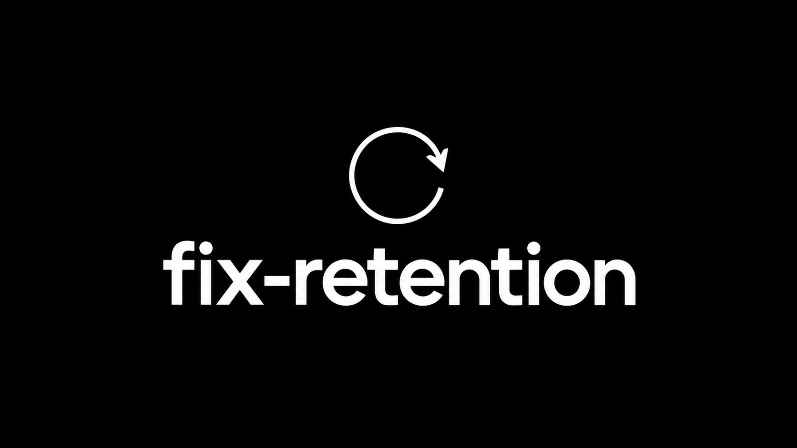

# fix-retention

An AI agent skill that investigates your SaaS and creates a practical plan to improve customer retention.

Works with agents supporting the Agent Skills format, including Claude Code, Codex, and Cursor. It studies the product, codebase, target users, available customer data, and accessible analytics before recommending changes.

## Install from GitHub

Run this command from your SaaS project:

```sh
npx skills add statiiiix/fix-retention --skill fix-retention
```

Requires Node.js/npm with `npx`. The installer lets you select your agent. To target one directly, append `--agent claude-code`, `--agent codex`, or `--agent cursor`. Add `--global` if you want a personal installation across projects.

The repository uses the `skills/fix-retention/SKILL.md` layout supported by the [Skills CLI](https://github.com/vercel-labs/skills). The installer is optional; the skill itself has no runtime dependencies.

### Manual download

On GitHub, select **Code → Download ZIP**, extract the archive, and copy the complete `skills/fix-retention/` folder into your SaaS project:

| Agent | Destination |
| --- | --- |
| Codex | `.agents/skills/fix-retention/` |
| Claude Code | `.claude/skills/fix-retention/` |
| Cursor | `.cursor/skills/fix-retention/` |

Keep `SKILL.md`, `references/`, and `agents/` together. Cursor also discovers `.agents/skills/`, so Codex and Cursor can share that installation. Avoid duplicate copies in locations the same agent scans.

## Use

Invoke `$fix-retention` in Codex, or `/fix-retention` in Claude Code and Cursor, or select the skill through your agent's skill picker. Then describe your concern:

> Understand this SaaS and its target customers. Inspect the codebase and available retention evidence, ask focused multiple-choice questions, and create a prioritized retention plan. Implement only when I ask.

It also supports automatic selection when your agent matches a request to the skill description.

## What it does

1. Understands who the product serves, what customers pay for, and when they should receive value again.
2. Inspects the relevant code and user journey, including onboarding, core workflows, background jobs, billing, and notifications.
3. Asks adaptive multiple-choice questions about unresolved context, using native question tools when available or chat choices otherwise.
4. Examines accessible analytics, feedback, and billing evidence. Checks whether tracking is actually configured and producing useful data.
5. Diagnoses retention gaps and selects suitable interventions: better onboarding, reliability, personalization, progress, streaks, social features, lifecycle messages, or payment recovery.
6. Produces up to three leading priorities with evidence, implementation touchpoints, measurement, rollout details, and deferred alternatives.
7. Saves findings so a later run can evaluate previous decisions and continue from them.

**Research and plan first. Implement when requested.** Low dashboard usage may be healthy for automated or occasional-use products; the skill evaluates recurring customer value and renewal as appropriate.

## Research included

The [research library](skills/fix-retention/references/research.md) contains 36 primary-source records covering Duolingo, Spotify, Netflix, LinkedIn, Strava, Slack, Snapchat, TikTok, Intercom, and behavioral studies and frameworks.

It distinguishes reported experiments, observational findings, documented product mechanics, and practitioner frameworks. Each recommendation should explain why the mechanism fits your SaaS. Another app's result is supporting context, not a promised lift.

## Analytics and access

No analytics vendor or connector is required. The agent can use existing authorized connectors, authenticated dashboards, or exports when its environment supports them. If evidence is unavailable, it identifies the gap and develops a provisional plan or a focused measurement proposal.

A skill does not grant account access. Planning does not activate messages, publish tracking, change billing, or deploy your app. Agent features and permission controls depend on the host.

## Repository structure

```text
skills/fix-retention/
├── SKILL.md
├── agents/openai.yaml
└── references/
    ├── discovery.md
    ├── analytics.md
    ├── interventions.md
    ├── plan-contract.md
    └── research.md
```

Read the [skill instructions](skills/fix-retention/SKILL.md) for the complete workflow.

## Validation status

The skill's metadata, internal reference links, and packaged files have been checked. Agent scenario evaluations covered an early-stage monthly reporting SaaS, a daily learning product with misleading retention comparisons, and a proposal-writing SaaS with unresolved customer segments and usage cadence.

The Skills CLI 1.5.22 discovered exactly one skill and successfully installed local project copies targeting Codex, Claude Code, and Cursor in an isolated workspace. The installed instructions, metadata, and five reference files were verified against the repository source. This checks the installer and file layout; full execution inside each host remains unverified.
